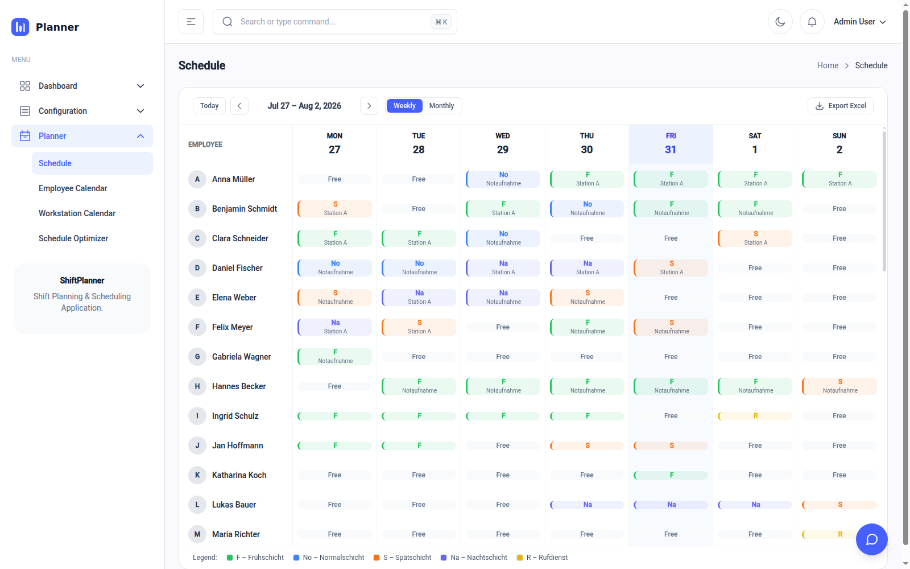
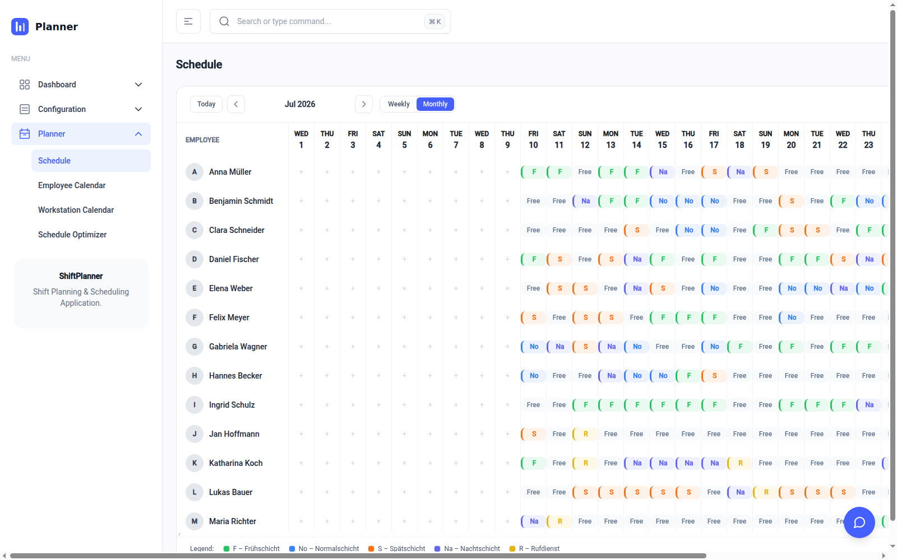
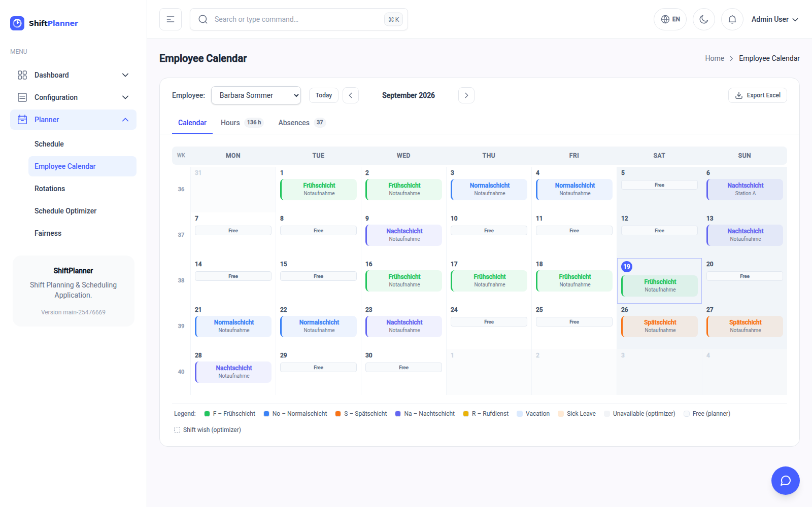
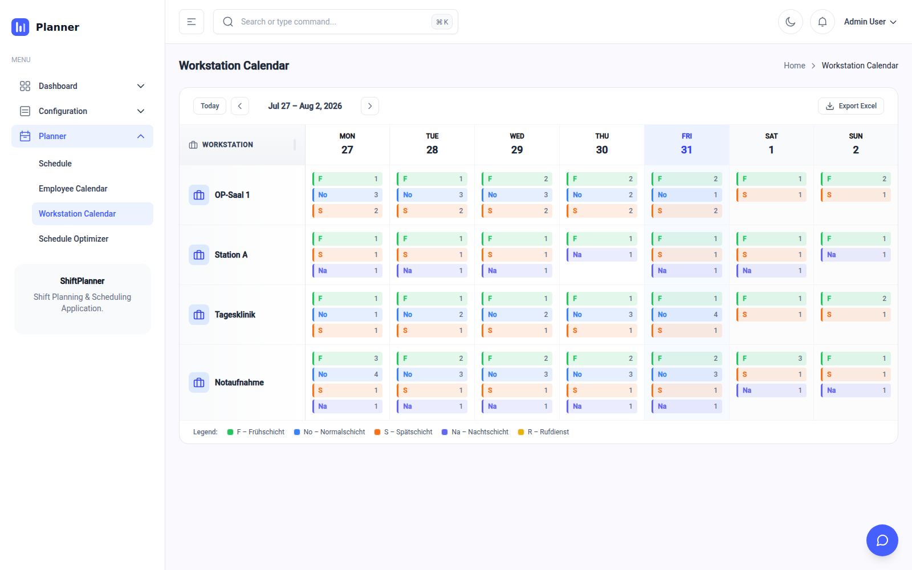
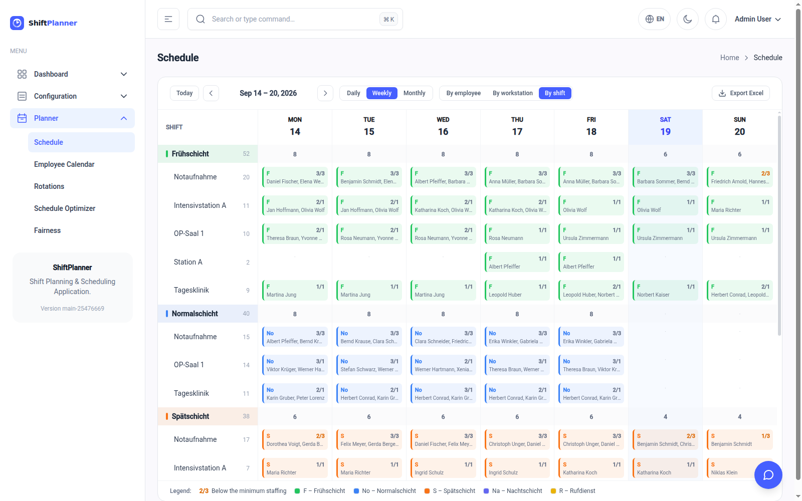
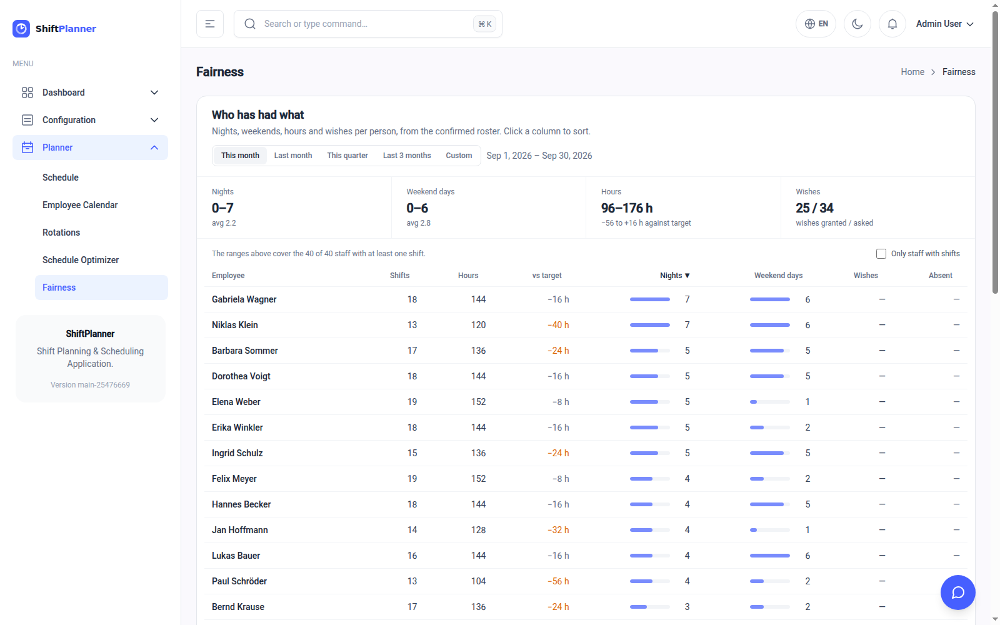
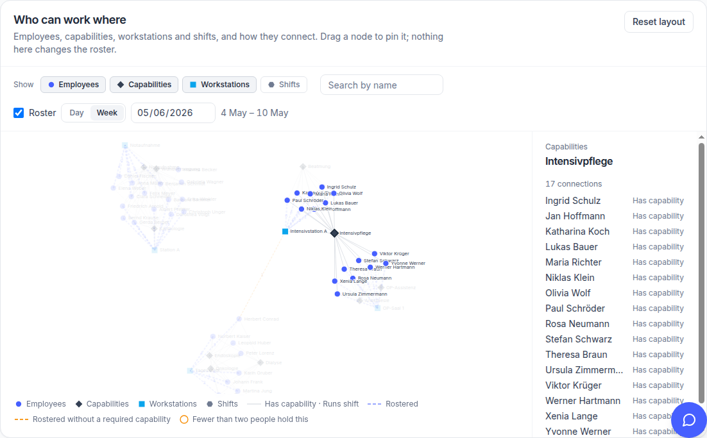

# Reading and adjusting the schedule

Once a roster is confirmed it appears in two calendars, and the Schedule reads
it three ways. They show the same information arranged differently — pick
whichever answers the question you actually have.

| View | Answers |
|---|---|
| **Schedule**, Week or Month | *Who is working, and when?* |
| **Schedule**, Day | *Who is on the ward at three o'clock?* |
| **Employee Calendar** | *What does one person's month look like?* |

*Is this place adequately covered?* is the Schedule view read **By
workstation**, and *is every early shift fully staffed?* is the same view **By
shift**. See [below](#coverage-by-place-the-schedules-workstation-view).

Both are under **Planner** in the menu. The week and month views, and the
Employee Calendar, have an **Export Excel** button in the top right that saves
exactly what you are looking at.

---

## Schedule — the master roster

One row per person, one column per day. Each square shows the shift's short
name and, below it, the workstation. Grey **Free** means a day off.

**Daily / Weekly / Monthly** switches the span; the page opens on the week.
Monthly fits the whole month across the screen; you scroll sideways to reach
the end of it. Daily shows one day hour by hour — see
[below](#day-one-day-hour-by-hour). Clicking a day's heading in the week or
month opens that day.

In the month view, **Wishes only** swaps the confirmed plan for the shift
wishes people have entered, so you can see at a glance who asked for what
before you calculate. Press it again to return to the plan.

The **legend** along the bottom decodes the abbreviations and colours — the
same colours you chose when setting up each shift.

### Changing a single day

Click any square.

- On a **day off**, a menu opens offering each shift, then each workstation.
  Pick a shift, then a workstation, and the person is scheduled.
- On an **existing assignment**, the same menu lets you switch to a different
  shift or move them to another workstation. A small delete button appears on
  hover to remove the assignment entirely.

Changes take effect immediately — this *is* the confirmed roster, not a
proposal. There is a confirmation step before deleting, but not before
changing.

!!! tip "Hand edits and recalculation"
    Anything you change here is overwritten if someone later confirms a
    calculated plan covering the same dates. For a few corrections that is
    fine. For a large reshuffle, it is safer to fix the underlying data
    (absences, availability) and recalculate.

### Swapping shifts with a colleague

Employees can arrange a swap themselves; a planner still has the last word.

1. **Ask.** Right-click one of your own shifts (today or later) and choose
   **Request a swap…**, then click the colleague's shift you would take
   instead — on the same day or another. Confirm with **Send request**.
   Nothing in the roster changes yet.
2. **Agree.** Your colleague opens **Swap requests** at the top of the Schedule
   and chooses **Accept** or **Decline**.
3. **Decide.** Planners see a number on the bell once a colleague has agreed.
   In **Swap requests**, **Review** shows what the swap would break for each of
   the two — too little rest, a missing qualification, a personal limit — and
   **Approve** or **Reject** decides. Approving exchanges the two shifts.

Warnings never stop an approval; they are there so you decide knowingly, and
they are kept in the [audit log](administration.md#the-audit-log). If either shift was changed
in the meantime, approval is refused and the request is marked *Roster changed*.
A request still open when its day comes is *Expired*. You can withdraw your own
request until it is decided.

On different days, each of you has to be free on the other's day. Planners do
not request swaps; they change the roster directly with **Swap with…**.

---

## Day — one day, hour by hour

**Daily** on the Schedule page. The arrows next to the date go back and forward
one day; **Today** returns to today and scrolls to the current hour.

One row per person, and across the top a 24-hour ruler instead of a row of days.
Each shift is a coloured bar spanning the hours it actually runs, labelled with
the shift and the workstation.

This is the view for questions about *time of day* rather than dates: who is on
the ward mid-afternoon, whether the handover between late and night is covered,
who is around if the CT list overruns.

- **A shift running past midnight** is cut off square at the right-hand edge and
  marked ↦; the rest of it appears at the left edge of the next day, marked ↤.
  A night shift is visible on both days it touches, the way the ward experiences
  it.
- **Absences** stretch across the whole row in their own colour, with the reason
  written in.
- **A red line marks the current time** when you are looking at today.
- **− and +** zoom the hours in and out; the chart scrolls sideways at any zoom,
  with the names pinned on the left.
- **Only scheduled** hides everyone with nothing that day, leaving just the
  people on duty.

The header counts how many are on duty, how many are away, and the total hours
planned for the day. The search box in the top bar filters by name.

---

## Employee Calendar — one person's month

Choose a person from the dropdown. The page has three tabs:

| Tab | What it shows |
|---|---|
| **Calendar** | The month as a wall calendar, with ISO week numbers down the side. |
| **Hours** | Planned hours for the month (the badge on the tab), per week and per shift, with overtime or undertime against the contract. |
| **Absences** | Vacation, sick leave and unavailability, where you add or remove date ranges. The badge counts the entries. |

The calendar shows:

- **Shifts** they are working, with the workstation underneath.
- **Absences**, colour-coded: vacation, sick leave, and days marked
  unavailable.
- **Free** days the planner explicitly gave them off.
- **Shift wishes**, drawn as an outlined chip with a star — see [Managing your
  staff](people.md#shift-wishes).

The **Hours** tab is the quickest way to check whether someone is heading over
or under their contract.

This is the view to print or export when somebody asks "what am I doing next
month?"

### Editing here

Click any empty day (the **+**) for a menu offering **Assign shift**, **Wish
shift (optimizer)** and **Workstation**; see [Shift wishes](people.md#shift-wishes).

Click an existing entry to open its details: the shift and workstation, who
else is on that shift, whether a wish was fulfilled, who or what entered it (a
person, or an optimizer run) and when it last changed. You can delete it from
there.

---

## Coverage by place — the Schedule's workstation view

Switch the Schedule view to **By workstation**: one row per workstation, one
column per day, each cell listing the shifts running there with the **number of
people assigned** to each.

This is the view for spotting holes. Reading across a row tells you whether a
unit is consistently covered; reading down a column tells you how a particular
day is shaping up. Cells below the **Min** you set on the shift or the
workstation are marked, so a day showing `1` where you asked for `3` stands out
as the real shortfall it is.

**By shift** turns the same grid around: one block per shift, one row per
workstation inside it, and the total per day in the shift's header row. It is
the quickest way to check a single shift across the ward, for instance that
every night is fully staffed.

!!! note "There used to be a separate page for this"
    The standalone *Workstation Calendar* showed the same confirmed plans, read
    only and for one week at a time. It has been folded into the Schedule view,
    which does the same thing over the week *or* the month and lets you edit
    what you find. Old links land on the Schedule page.

---

## Fairness — who has had what

**Planner → Fairness** lists everyone with their share of the confirmed roster
over a period: *This month*, *Last month*, *This quarter*, *Last 3 months*, or a
custom range.

| Column | What it counts |
|---|---|
| **Shifts**, **Hours** | Shifts worked and their hours. |
| **vs target** | Hours over or under the contracted hours — weekly hours × days ÷ 7 for the period. Amber when more than 10 % off. |
| **Nights** | Shifts that run past midnight. |
| **Weekend days** | Saturdays and Sundays worked; hover for how many weekends that touched. |
| **Wishes** | Shift wishes granted, of those asked. |
| **Absent** | Days marked sick, on leave or holiday — not plain days off. |

Click any column heading to sort by it — most first, click again for least. The
four figures at the top give the range across everyone who worked, so a gap of
0–10 nights stands out before you read a single row. **Only staff with shifts**
hides people with nothing in the period. Click a name to open that person's
calendar.

It reads the **confirmed** roster only. To see how a proposal would share the
work before you take it, use **Compare** on the Schedule Optimizer.

## Relationships — who can work where

**Reports → Relationships** draws your ward as a network: everyone, every
capability, every workstation and every shift, with a line for each
connection. It answers questions like *who could cover the ICU?* or *which
qualification rests on one person?* at a glance. Planners and admins see it;
staff with the viewer role do not, since it shows everyone's qualifications.

| Shape | Is | A line to it means |
|---|---|---|
| ● circle | an employee | — |
| ◆ diamond | a capability | the employee has it, or the workstation requires it |
| ■ square | a workstation (hollow when closed) | — |
| ⬢ hexagon, in the shift's colour | a shift | the employee may work it, or the workstation runs it |

**Roster** adds what was actually planned: pick a **Day** or a **Week** and
a dashed line joins each person to the workstation and shift they are
rostered on, with the number of days. A line in amber means the person is
rostered at a workstation that requires a capability they don't have.
Absences and days off are not drawn.

An **amber ring** around a capability marks a single point of failure: an open
workstation requires it and fewer than two people hold it.

Click a node to light up its neighbours and list them on the right; click
the background to clear it. **Show** hides or shows each kind of node —
shifts start hidden because they connect to almost everything — and the
search box highlights matching names. Drag a node to move it out of the
way; it stays where you drop it until you double-click it. **Reset layout**
releases every node and fits the picture to the window.

Nothing on this page changes anything: dragging a person onto a workstation
moves a dot on the screen, not a shift in the roster.

---

## Analytics — the ward over time

**Reports → Analytics** looks back over up to a year: was the ward short,
who carried the nights and weekends, who was absent, what changed after a
month was published, who edited what, and how planning runs went. Planners
and admins see it; viewers do not. Like Relationships, it only reads.

**Filters.** One bar at the top applies to everything on the page: a
period (this month, last month, this quarter, last 3 or 12 months, or your
own dates, at most a year) and any number of workstations, shifts, people,
capabilities, absence types and change sources. Filtering by a capability
keeps the people who hold it.

**Click to narrow.** Clicking a bar, a slice or a day in the heatmap narrows
every other chart and the table to it. Each click adds a chip next to the
filters; click the same element again, or the chip's ×, to undo it, and
**Clear all** to start over. The chart you clicked keeps showing the rest,
with your pick highlighted, so you can change your mind there.

**Share a view.** Everything you set — period, filters, clicks, tab, search —
is in the page address. Copy it to send a colleague exactly what you see, or
bookmark it.

| Tab | Answers |
|---|---|
| **Staffing & coverage** | Days short of the minimum, as a head count against the minimum and a calendar heatmap; shortfall by shift and by workstation; where a maximum was exceeded. Draft months are shaded — they may still change |
| **Hours & fairness** | Hours against each person's target, nights, weekend days and holiday shifts per person and per month, and how widely they spread across the team |
| **Absences** | Absence days by type, person, weekday and over time — a Monday pattern shows here. A plain *not rostered* day is not an absence |
| **Roster changes** | Change notices after publication: when, from where (edit, absence, swap, replacement, new plan), by whom, to whom, how many with a reason, and how long until people read them |
| **Audit activity** | Audit entries by action, item type and person. Each row of the table opens the **Audit log** filtered to exactly those entries |
| **Planning runs** | Runs by source (manual, automatic) and outcome, how long they took, and how many automatic plans became the roster or stayed a proposal |

The counting is the same as elsewhere: shortfalls are counted the way
**Verify Plan** counts them (a public holiday uses the Sunday minimum, a
closed workstation needs nobody), and hours, nights and weekends match the
**Fairness** page for the same period. If you filter by people, the head
count shrinks but the minimum stays the ward's — the page says so.

Under the charts, the **table** lists the rows behind what you see. Sort by
any column, search it, and **Export CSV** to take exactly those rows to a
spreadsheet. Each chart's menu icon saves it as a picture.

---

## Exporting

Every calendar has an **Export Excel** button that exports the current view —
the week or month you are looking at, in the arrangement you are looking at.

Use it to:

- print or circulate the roster;
- send one person their own month from the Employee Calendar;
- keep an archive copy before recalculating a period.

---

## The dashboard as a quick check

Before you go digging through calendars, the **Dashboard** often answers the
question already: today's coverage per workstation, how many people are on
leave, and the planned-hours-per-day chart that reveals unplanned stretches at
a glance. See [First steps](first-steps.md#the-dashboard-explained).
